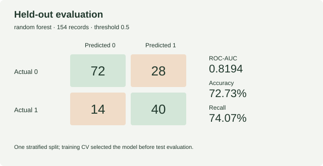

# Diabetes classification benchmark

[](https://github.com/yousufpatel41-collab/diabetes-prediction/actions)

An exploratory comparison of three scikit-learn classifiers on [OpenML diabetes ID 37, version 1](https://www.openml.org/d/37). This historical sample is used for learning model evaluation, not clinical decisions.

**Source correction, 12 October 2026:** the previously included CSV had unverified provenance and 188 positive outcomes. It has been explicitly replaced with the documented OpenML source: 768 records, 500 negative and 268 positive. All previous metrics, including the 92.11% accuracy claim, are superseded. See [DATA_SOURCES.md](DATA_SOURCES.md) and `data/source_manifest.json`.

## Run

Use Python 3.11 or 3.12 in a virtual environment, from the repository root:

```shell
pip install -r requirements.txt
python src/download_data.py
python src/train_all.py
python src/build_evaluation_report.py
python -m unittest discover -s tests -v
```

The repository includes the source ARFF, converted CSV and recorded checksums. The download command retrieves the pinned source again and checks its raw SHA-256 before conversion; tests verify the resulting CSV against its manifest.

## Evaluation

Zeros in Glucose, BloodPressure, SkinThickness, Insulin and BMI become missing values. Zero pregnancies remain valid. A stratified 20% test set is reserved before fitting anything. Median imputation, scaling and SMOTE are fitted inside each training fold. Five-fold training ROC-AUC selects the classifier before test evaluation; the classification threshold is 0.5.

The test set has 154 records, including 54 positive outcomes. Comparisons below are descriptive; repeatedly tuning on this same test set would invalidate its role as a holdout.

| Model | Training CV AUC | Test AUC | Accuracy | Recall | Precision |
|---|---:|---:|---:|---:|---:|
| Decision Tree | 0.7385 | 0.7512 | 72.08% | 66.67% | 59.02% |
| Random Forest (selected) | 0.8322 | 0.8194 | 72.73% | 74.07% | 58.82% |
| Gradient Boosting | 0.8097 | 0.8020 | 72.08% | 64.81% | 59.32% |

`outputs/metrics.json` records the exact dataset checksum, seed, split sizes, CV scores, confusion matrices and held-out metrics. Training creates `models/selected_pipeline.pkl`, which contains the complete preprocessing and classifier pipeline. Only load models you trained yourself.

## Limits

This is a small historical sample from a specific population of adult women. One train/test split does not establish robustness or performance in other populations. Probability calibration and external validation have not been tested. No best-in-class, clinical screening or achieved business outcome claim is made. No SHAP analysis or Power BI dashboard is included.

## Checks

Tests check source and CSV hashes, expected class counts, handling of invalid zeros, preservation of prediction row counts and training-only imputation statistics. CI also runs the complete model comparison to verify that it executes with the pinned dependencies.

## Licence and data rights

Authored code and documentation: [MIT](LICENSE). The OpenML registry labels the external data licence “Public”; that dataset is not relicensed as MIT. Attribution and replacement history are in [DATA_SOURCES.md](DATA_SOURCES.md).

## Evaluation chart



Recreate this chart with `python src/build_evaluation_report.py` after training. It displays recorded holdout counts; it is not a SHAP or feature-importance plot.
